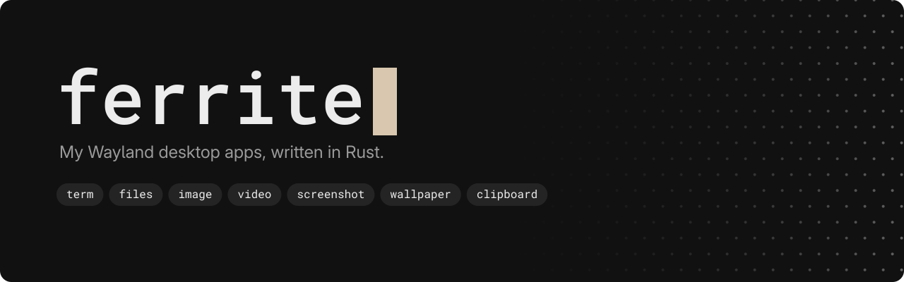
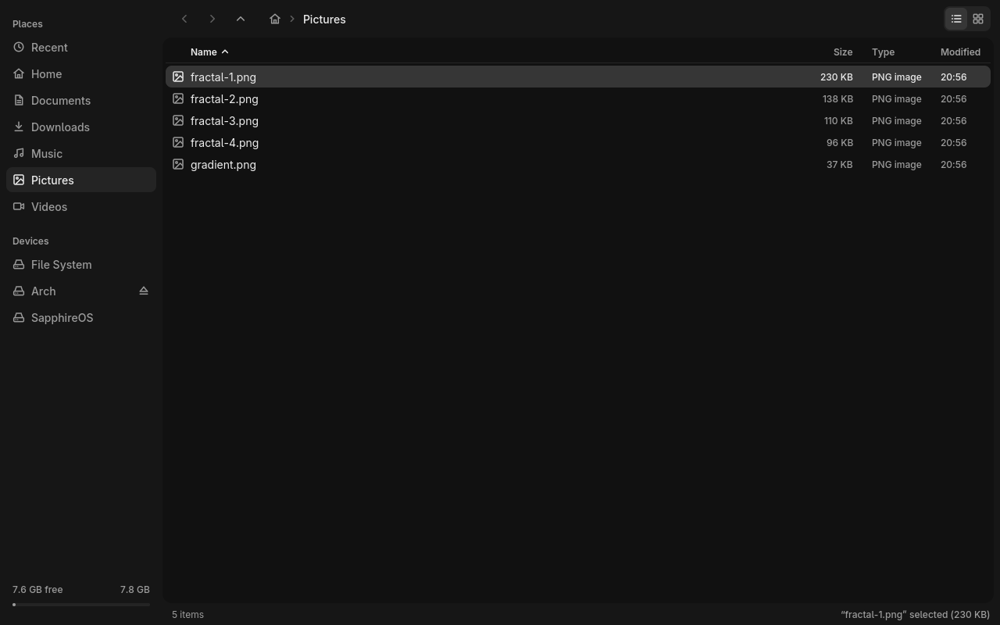

<div align="center">



<br>

[](#requirements)
[](#requirements)
[](#build-from-source)
[](#license)

A terminal, file manager, image viewer, video player, screenshot tool, wallpaper setter,
clipboard keeper and polkit password popup, made for my own Hyprland setup. I built them
with Claude: I decide what each app does and how it looks, Claude writes most of the code,
and I use them every day.
Three of them need nothing but libc.




</div>

## Tools

| Tool | What it does | System libraries |
|---|---|---|
| [`term`](term) | Terminal: tabs, reflow, own font rendering | fontconfig, xkbcommon |
| [`files`](files) | File manager: tabs, split view, thumbnails, search, drives, undo | + cairo, librsvg, libwebp |
| [`image`](image) | Image viewer: PNG, JPEG, GIF, WebP, SVG; zoom, pan, browse a folder | + cairo, librsvg, libwebp |
| [`video`](video) | Video player on libmpv, GPU decode | + libmpv, EGL, gbm |
| [`screenshot`](screenshot) | Full screen in ~20 ms, or freeze + pick a region or window | none |
| [`wallpaper`](wallpaper) | Wallpaper daemon: `wallpaper <image>` | none |
| [`clipboard`](clipboard) | Keeps your last copy (text or image) alive after its app closes | none |
| [`auth`](auth) | Password popup when an app needs more rights (polkit agent) | fontconfig, xkbcommon |

Libraries the tools share: [`frame`](frame) (windows, input, fonts, UI) and
[`pix`](pix) (image decoding and scaling).

## Speed and memory

| Tool | Start | Memory | CPU while idle |
|---|---|---|---|
| `term` | 29 ms | 23 MB | 0 |
| `files` | 27 ms (100 files), 55 ms (10,000) | 27–30 MB | 0 |
| `image` | 51–95 ms (SVG to 4K PNG) | 45–116 MB | 0 |
| `video` | 141–150 ms, GPU decode | 147–213 MB | 0 when paused, 2–3% playing |
| `screenshot` | 20 ms for two 1080p outputs | 34 MB peak | (exits) |
| `wallpaper` | 16 ms (1080p) to 137 ms (4733x2662) per switch | 2.5 MB | 0 |
| `clipboard` | (daemon) | under 1 MB + the copy | 0 |
| `auth` | (daemon) | 3.8 MB while no popup is open | 0 |

Medians of 20 to 100 runs each, on a 6-core desktop CPU from 2019. Each tool's README
has the details and how it was measured.

## Requirements

- Arch Linux or Fedora (or a distro based on them), x86_64, with a Wayland compositor.
  No other systems.
- `wallpaper` and the `screenshot` freeze overlay need wlr-layer-shell; `screenshot` needs
  wlr-screencopy; `clipboard` needs ext- or wlr-data-control. Hyprland, sway and niri have
  them; GNOME does not. Picking a window in `screenshot` uses Hyprland.
- `auth` needs polkit 126 or newer (its socket-activated helper) and a logind session.

## Install

Prebuilt for Arch Linux and Fedora (x86_64), checked with SHA-256, installed to `~/.local/bin` (no root):

```sh
curl -fsSL https://raw.githubusercontent.com/uhm26/ferrite/main/install.sh | sh -s -- term files    # any tools
```

Every tool is prebuilt. Run it again to update; `--uninstall` removes a tool (and its menu
entry), `--help` lists the options. If `~/.local/bin` is not on your PATH yet, it adds
it to your bash, zsh and fish config, so new terminals run the tools by name. Tools that need system libraries tell you the exact
packages to install as one `pacman` or `dnf` line.

## Build from source

Needs Rust (stable) and the system libraries listed above (with their development files).

```sh
git clone https://github.com/uhm26/ferrite
cd ferrite
cargo build --release -p term      # one tool at a time, see below
cp target/release/term ~/.local/bin/
```

Build tools one at a time (`-p <tool>`). A plain `cargo build --workspace` builds `pix`
once with every feature any tool asks for, so `wallpaper` would link WebP and SVG
libraries it never uses.

## License

MIT or Apache-2.0, at your option: [LICENSE-MIT](LICENSE-MIT), [LICENSE-APACHE](LICENSE-APACHE).
