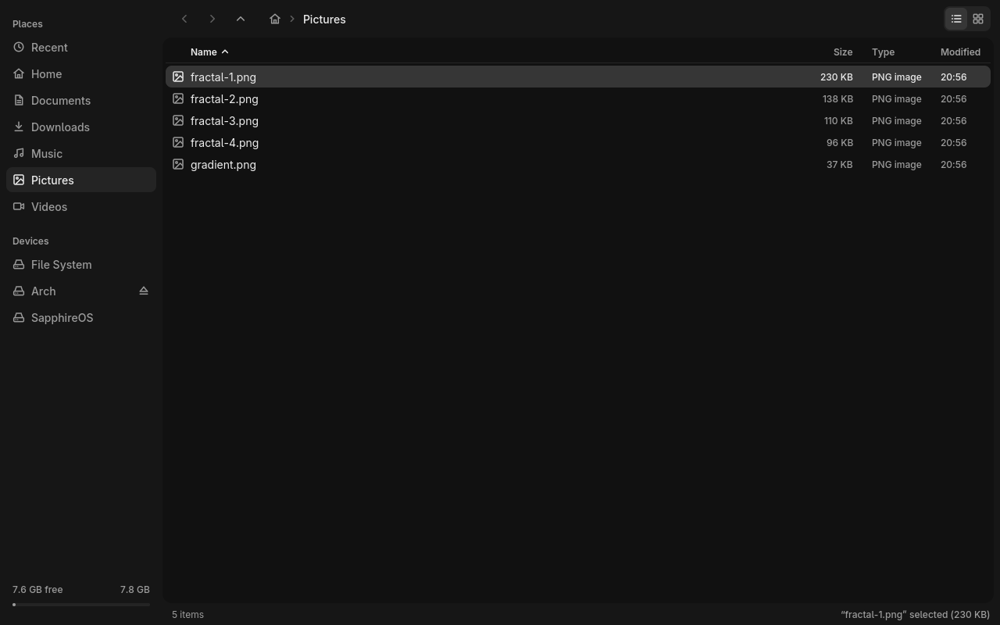

# files

> A Wayland file manager with a Nemo-like layout: places on the left, a list or grid of files on the right.



## Features

- Sidebar with Recent, Home, the usual home folders (Desktop, Documents, Downloads, Music,
  Pictures, Videos) when they exist, Trash, bookmarks (GTK's file, shared with Nemo and
  GTK apps), File System and plugged-in drives.
  Free space of the current disk at the bottom. Drag its edge to resize; it folds to
  icons in narrow windows.
- List view with Name, Size, Type and Modified columns. Click a column title to sort by
  it, again to reverse. Folders always come first.
- Grid view with four tile sizes. PNG, JPEG, GIF, WebP and SVG files show thumbnails,
  made in the background.
- Tabs, and a split view that shows two tabs side by side.
- Type-to-find, a live filter, a search through all subfolders that shows results as
  they come in, and Recent files (from `recently-used.xbel`, which GTK apps write).
- Drives through udisks2: click a drive to mount it and go there, click its eject button
  to unmount it (and power it off when it is removable).
- Drag and drop: onto folders, sidebar places, tabs or the other pane, and out to (or in
  from) other apps as `text/uri-list`.
- Copy and move run in the background with a progress bar and a cancel button. If a name
  is already taken you choose Keep Both, Replace or Skip. Replace moves the old file to
  the Trash.
- Undo (Ctrl+Z) for copy, move, rename, trash, new files and folders, links, extract and
  compress.
- Trash that follows the FreeDesktop spec, so it is shared with other file managers.
  Restore, Delete Forever (asks first), and a hold-to-confirm Empty Trash button.
- Rename many files at once: `Trip #` numbers them (extensions stay), `old/new` replaces
  text in every name.
- Archives through `bsdtar`: Extract Here, and Compress to `.zip`, `.tar.gz` or `.tar.zst`.
- New menu: folder, text, Markdown, Rust, shell script (executable) or empty file, plus
  any files in `~/Templates`.
- Open With: apps from `.desktop` files that handle the file's type, Set Default App
  (through `xdg-mime`), or any typed command.
- Info pane: type, size (folder totals are counted in the background), dates,
  permissions (click to change), location, and the first lines of a text file.
- Folders refresh on their own when their contents change (inotify).
- A file picker for other apps, as an xdg-desktop-portal backend.

## Install

One-line installer: coming soon (see the [main README](../README.md)).

Build from source:

```sh
cargo build --release -p files
cp target/release/files ~/.local/bin/
```

Or run `files/install.sh`. It builds `files` and installs, for the current user:

- the binary to `~/.local/bin/files`,
- `files.desktop` to `$XDG_DATA_HOME/applications/` and `files.svg` to
  `$XDG_DATA_HOME/icons/hicolor/scalable/apps/`,
- the file picker portal: a D-Bus service file that starts `files --portal`, the backend
  file `files.portal` in `$XDG_DATA_HOME/xdg-desktop-portal/portals/`, and
  `$XDG_CONFIG_HOME/xdg-desktop-portal/hyprland-portals.conf`, which makes `files` the
  file chooser and leaves everything else to the Hyprland portal.

It overwrites an existing `hyprland-portals.conf`. On another compositor, put
`org.freedesktop.impl.portal.FileChooser=files` under `[preferred]` in that desktop's
`portals.conf`. Then run `systemctl --user restart xdg-desktop-portal` once.

## Usage

```
files [FOLDER]
files --pick open|dir|save [--multiple] [--title TEXT] [--accept LABEL] [--name FILE] [FOLDER]
files --portal
```

```sh
files                 # open your home folder
files .               # open the current folder
files --pick open --multiple ~/Pictures   # pick files, print their paths
```

If the folder can't be opened, `files` opens home (or `/`) and shows why.

`--pick` opens one picker window: Cancel and an accept button sit in the toolbar, and
save mode adds a name field. `open` picks files, `dir` picks the folder shown, `save`
picks a new file name in it (saving over an existing file needs a second press). The
picked paths go to stdout, separated by NUL bytes. Cancelling exits with status 1.

`--portal` serves `org.freedesktop.impl.portal.FileChooser` (OpenFile, SaveFile,
SaveFiles) on the session bus. D-Bus starts it on the first request. Each request opens a
picker window. It quits after 5 idle minutes.

## Keys and mouse

**Navigation**

| Key | Action |
|---|---|
| Up / Down | Move the cursor (by a row in the grid) |
| Left / Right | List: parent folder / open. Grid: previous / next |
| Home / End, PgUp / PgDn | First / last entry, one page up / down |
| Return | Open: enter a folder, or open a file with its default app (`xdg-open`) |
| Backspace, Alt+Up | Parent folder |
| Alt+Left / Alt+Right | Back / forward |
| Alt+Home | Home folder |
| Ctrl+L, or type `/` or `~` | Edit the path (Return goes there; a file opens its folder with it selected) |
| Typing a name | Jump to the first match (Backspace deletes a letter, Esc clears) |

**Selection**

| Key | Action |
|---|---|
| Shift+Up / Shift+Down | Extend the selection |
| Ctrl+A | Select all |
| Esc | Clear the filter, else end the search, else clear the selection |

**File operations**

| Key | Action |
|---|---|
| Ctrl+C / Ctrl+X / Ctrl+V | Copy / cut / paste files (copy and cut also put the paths on the clipboard) |
| F2 | Rename (several selected: rename them all) |
| Delete | Move to Trash. In the Trash: Delete Forever (press twice) |
| Ctrl+Z | Undo the last operation |
| Ctrl+Shift+N | New folder |
| Ctrl+Alt+N | New text file |
| Ctrl+Shift+C | Copy the path of the selection (or the folder) |
| Ctrl+D | Add or remove a bookmark |
| F4 | Open a terminal here (`$TERMINAL`, else `term`) |
| Ctrl+I | Show or hide the info pane |
| Menu, Shift+F10 | Context menu |
| Return / Esc | In the name-conflict prompt: Keep Both / Cancel |

**Tabs and split view**

| Key | Action |
|---|---|
| Ctrl+T | New tab on the same folder |
| Ctrl+W | Close the tab (the window, on the last one) |
| Ctrl+PgUp / Ctrl+PgDn | Previous / next tab |
| Tab | Switch to the other pane (split view) |
| F5 / F6 | Copy / move the selection to the other pane's folder |
| F3 | Back to one pane |

**Search**

| Key | Action |
|---|---|
| Ctrl+F | Filter this folder (Return searches subfolders instead) |
| Ctrl+Shift+F | Search this folder and all subfolders |

**View**

| Key | Action |
|---|---|
| Ctrl+H | Show or hide hidden files |
| Ctrl+= or Ctrl++ / Ctrl+- | Bigger / smaller grid tiles |
| Ctrl+0 | Smallest grid tiles |
| Ctrl+Q | Quit |

**Mouse and drag**

| Input | Action |
|---|---|
| Click / double-click | Select / open |
| Ctrl+click, Shift+click | Add or remove one, select a range |
| Drag on empty space | Selection box (Ctrl adds to the selection) |
| Right-click | Context menu for the entry or the folder |
| Middle-click a folder or place | Open it in a tab behind this one |
| Middle-click a tab | Show it beside this one (again: one pane) |
| Mouse back / forward buttons | Back / forward |
| Ctrl+wheel | Grid tile size |
| Drag files | Move onto a folder, place, tab or pane. Hold Ctrl to copy. Files from other apps are copied |
| Drag a tab, click its × | Reorder, close |
| Ctrl+click an app in Open With | Open with it and make it the default |

## Configuration

There is no config file. View settings (list or grid, hidden files, sort, tile size) are
not saved between runs. Bookmarks, the Trash and default apps are stored in the shared
files listed below.

## Files

| Path | Use |
|---|---|
| `$XDG_CONFIG_HOME/gtk-3.0/bookmarks` | Bookmarks (read and written, shared with GTK) |
| `$XDG_DATA_HOME/Trash/files/`, `Trash/info/` | The Trash (FreeDesktop spec) |
| `~/.local/share/recently-used.xbel` | Recent files (read only, up to 200) |
| `~/Templates/` | Templates for the New menu (up to 12) |
| `$XDG_DATA_HOME/applications/`, `$XDG_DATA_DIRS/*/applications/` | Apps for Open With |
| `mimeapps.list` (through `xdg-mime default`) | Set Default App |

Thumbnails are kept in memory only. Nothing is written to a cache folder.

## Requirements

- A Wayland compositor with `wl_compositor` v4, `wl_shm` and `xdg_wm_base`.
  `wl_data_device_manager` is needed for the clipboard and drag and drop, and
  `wp_cursor_shape_manager_v1` for cursor shapes. Drawing is done on the CPU.
- System libraries: fontconfig, freetype, xkbcommon, cairo, librsvg, glib (gobject) and
  libwebp (`libwebpdemux`). The UI font is Adwaita Sans.
- `xdg-utils` (`xdg-open`, `xdg-mime`) to open files and pick apps; `bsdtar`
  (libarchive) for Extract and Compress.
- udisks2 on the system bus for drives (optional: without it the Devices list shows only
  File System). Mounting internal disks needs a polkit rule, since `files` has no polkit
  agent to ask for a password.
- xdg-desktop-portal and a D-Bus session bus for the file picker.
- x86_64 with glibc (the few libc calls use x86_64 glibc struct layouts).

## Limitations

- Home Trash only. Trashing a file on another filesystem fails with an error.
- The picker ignores file type filters from the app: every file is shown.
- The home folder names (Desktop, Documents, …, Templates) are the English ones;
  `user-dirs.dirs` is not read.
- File types come from a small extension table, not the shared MIME database.
- Thumbnails only for pictures (no video), files up to 64 MiB, and only in the grid.
- Search stops at 5000 results, stays on one filesystem and doesn't follow links into
  other folders.
- Pasting reads text only: an image on the clipboard pastes nothing.
- Folders on filesystems where inotify fails (some network mounts) don't refresh on
  their own.
- Apps with `Terminal=true` always run in `term -e`. Dark theme only. No network places.

## License

MIT or Apache-2.0, see the [main README](../README.md#license).
