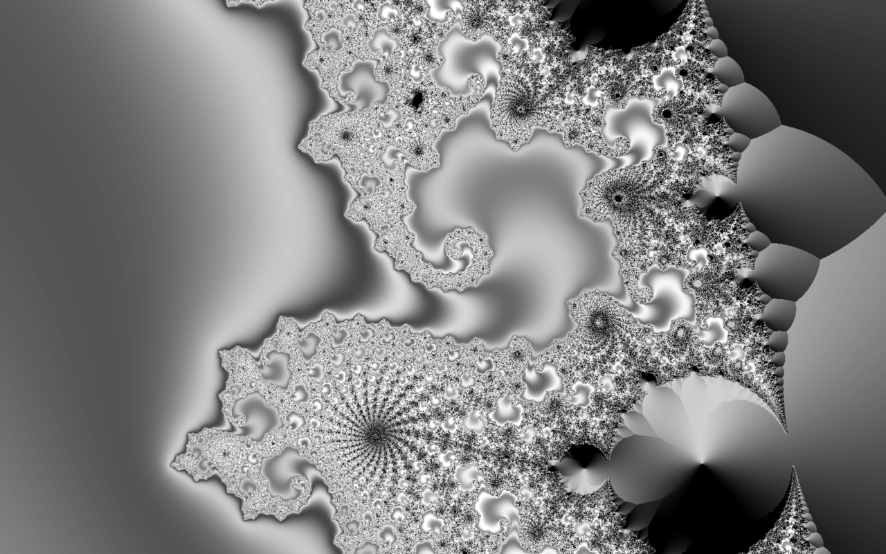

# image

> A small, fast image viewer for Wayland.



## Features

- Opens PNG, JPEG, GIF, WebP and SVG. The format is detected from the file's first bytes,
  not its name.
- Plays animated GIF and animated WebP.
- Applies the EXIF orientation of JPEG photos, so phone pictures show upright.
- Fits the whole picture in the window by default and refits when the window resizes.
- Zoom with the wheel (around the pointer) or the keyboard (around the middle). Zooming
  glides smoothly, never goes below fit and stops at 32x. From 4x on, pixels show as
  sharp squares.
- Pan by dragging with the left mouse button. The picture can't be dragged off screen.
- Browses the folder: step to the next or previous image, or jump to the first or last.
  The neighbors decode in the background, so stepping is instant.
- Rotates a quarter turn either way, with a short spin animation.
- Copies the current image to the clipboard as PNG.
- Moves the current file to the trash, in the standard FreeDesktop layout, so file
  managers can restore it.
- The window opens in the shape of the first picture. Pictures of another shape get a
  blurred, dimmed copy of themselves behind them instead of black bars.
- The title shows the file name, its place in the folder, its size and the zoom level.
- Uses no CPU while idle.

## Install

One-line installer: coming soon (see the [main README](../README.md)).

Build from source (needs Rust stable and the libraries under [Requirements](#requirements)):

```sh
git clone https://github.com/uhm26/ferrite
cd ferrite
cargo build --release -p image
cp target/release/image ~/.local/bin/
```

Or run `image/install.sh`. It builds a release binary and installs, for your user only:

- the binary to `~/.local/bin/image`
- a desktop entry to `$XDG_DATA_HOME/applications/image.desktop`, listing PNG, JPEG,
  GIF, WebP and SVG, so `image` shows up under "Open with"
- an icon to `$XDG_DATA_HOME/icons/hicolor/scalable/apps/image.svg`

`$XDG_DATA_HOME` defaults to `~/.local/share`. The script does not make `image` your
default viewer. To do that yourself:

```sh
xdg-mime default image.desktop image/png image/jpeg image/gif image/webp image/svg+xml
```

## Usage

```
image FILE
image FOLDER
```

Opening a file also loads the other images in its folder, so you can step through
them. Opening a folder starts at its first image. Images are sorted by name, ignoring
case.

```sh
image ~/Pictures/photo.jpg
image ~/Pictures
```

For testing, `image --png OUT [--size WxH] FILE` renders one frame to a PNG file
without a compositor (default size 960x640).

## Keys and mouse

Browsing:

| Key | Action |
|---|---|
| Right, Space, Page Down | Next image |
| Left, Backspace, Page Up | Previous image |
| Home | First image |
| End | Last image |

Stepping stops at the ends of the folder; it does not wrap around.

Zoom and view:

| Key | Action |
|---|---|
| `+`, `=`, keypad `+` | Zoom in |
| `-`, keypad `-` | Zoom out |
| `0`, `f` | Fit to window |
| `1` | Actual size (1:1) |
| Mouse wheel | Zoom in or out around the pointer |
| Left drag | Pan |

Image:

| Key | Action |
|---|---|
| `r` | Rotate clockwise |
| `Shift+r` | Rotate counter-clockwise |
| `Ctrl+c` | Copy the image to the clipboard (PNG) |
| Delete | Move the file to the trash and show the next one |
| `q`, Escape | Quit |

## Files

- Reads the image you open and lists the images in its folder (`.png`, `.jpg`, `.jpeg`,
  `.gif`, `.webp`, `.svg`, any case).
- Delete moves the file to `$XDG_DATA_HOME/Trash/files/` and writes a matching
  `.trashinfo` file to `$XDG_DATA_HOME/Trash/info/` (default `~/.local/share/Trash`).
- Nothing else is written. There is no config file.

## Requirements

- Linux with a Wayland compositor (needs `wl_compositor` v4, `wl_shm` and xdg-shell).
- System libraries, with their development files to build: fontconfig, freetype,
  xkbcommon, libwebp (libwebpdemux), librsvg, cairo and glib.
- The window text uses the Adwaita Sans font if it is installed; fontconfig picks a
  fallback otherwise. Text only shows when an image can't be opened.

## Limitations

- Rotation is only in memory. The file on disk is never changed.
- Delete asks no question and has no undo inside the viewer. Restore the file from the
  trash with a file manager.
- Only the home trash is used. Deleting a file on another drive fails with a message in
  the title.
- The copied image stays on the clipboard only while the viewer is open, unless a
  clipboard manager (such as [`clipboard`](../clipboard)) keeps it.
- Copy puts the full image (rotated, current animation frame) on the clipboard, not the
  zoomed view.
- EXIF orientation is read from JPEG only, not from PNG or WebP.
- Animated PNG (APNG) shows as a still image.
- An SVG is rendered once, at the size of its window. Zooming in enlarges its pixels.
- Transparent areas show on the window background color. There is no checkerboard.
- Very long animations are cut off at about 1 GiB of decoded frames and loop early.
- The window's first size is capped at 1440x810, whatever your screen size. After that
  the window keeps its size when you step to other images.
- Names sort as plain text, so `img10` comes before `img2`.
- No HiDPI support: on a scaled output the compositor stretches the window.
- The window draws no title bar of its own. On compositors that expect apps to draw
  one (such as GNOME), it has none.
- Up to three decoded images stay in memory (the current one and its neighbors).

## License

MIT or Apache-2.0, see the [main README](../README.md#license).
